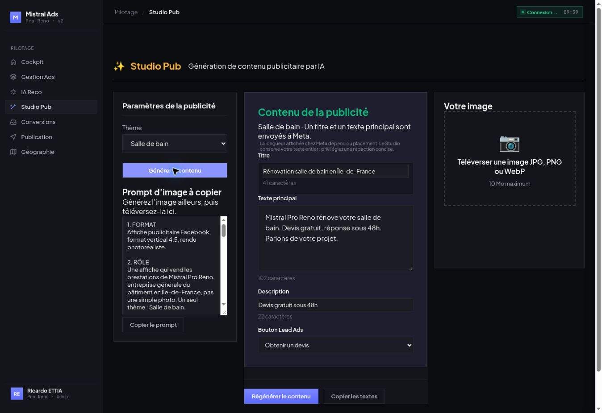

# Annexe CODE-033 — Studio Pub simplifié

## Bases et références

- Pré-vol du hub : `3c76d6d8a572ff1cb0e07ce4c092790e1db72691` ; CODE-033 et REFERENCE-CREAS lus avant modification.
- Backend de départ : `e6b6e520c685103e56df87fe0e8a2fbf774b0681`.
- Frontend de départ : `c9f0d821a6df43810d04fb16d3d4e3163a01788b`.
- Branche isolée des deux dépôts : `code-033-studio-simple`.
- Référence de marque : `projets/facebook-ads/documentation/REFERENCE-CREAS.md`, huit sections et invariants repris.

## A — constats avant de corriger

| Point | Constat établi | Source / limite |
|---|---|---|
| Structure Lead Ads image | Page, image, message, description, lien et CTA associé au formulaire ; un message dans le link_data du créatif simple. | [Meta — Lead Forms for Ads, étape 4](https://developers.facebook.com/documentation/ads-commerce/marketing-api/guides/lead-ads/create). |
| Titre | Headline disponible comme titre de créatif ; l'asset feed expose aussi des titres. | [Meta — Ad Creative](https://developers.facebook.com/documentation/ads-commerce/marketing-api/reference/ad-creative) et [Asset Feed Spec Options](https://developers.facebook.com/documentation/ads-commerce/marketing-api/ad-creative/asset-feed-spec/options). |
| CTA formulaires Lead Ads | APPLY_NOW, DOWNLOAD, GET_QUOTE, LEARN_MORE, SIGN_UP, SUBSCRIBE. | Guide Lead Forms, étape 4. CONTACT_US, BOOK_NOW et CALL_NOW retirés du sélecteur Studio. |
| Plafonds techniques de caractères | Aucun plafond dur applicable au créatif image Lead Ads établi dans les pages officielles accessibles. | La référence Ad Creative affiche notamment des longueurs « recommended » pour certains formats ; elles ne prouvent pas un plafond Lead Ads Feed. |
| Guide de placements | Le guide image Facebook Feed/Lead Generation n'a pas pu être lu. | [Meta Ads Guide](https://www.facebook.com/business/ads-guide/image/facebook-feed/lead-generation) : erreur HTTP en lecture directe ; récupération web désactivée. Aucun accès au compte Meta ni contournement effectué. |
| Valeurs 40/125/255/30 | Elles étaient présentées et appliquées comme plafonds Meta sans preuve correspondante. | Correction : aucun maxlength ni troncature automatique à ces nombres dans la génération et l'éditeur Studio. |
| Repères du générateur | 40/125/30 restent uniquement des objectifs de concision locaux clairement désignés comme éditoriaux dans le prompt texte. | Ils ne sont pas annoncés comme limites techniques de Meta. |
| Textes court et long auparavant | Création : preparePublishData choisissait le long ; le court servait au résumé d'aperçu. Édition : saveEditedAd lisait le court en premier. | Code de départ, ai-creation.js et publish.js. Flux désormais unifié sur le texte principal. |
| Titres multiples | Des tableaux titles/bodies existent réellement via asset_feed_spec ; ce n'est pas une invention universelle du dashboard. | [Meta — Asset Feed Spec](https://developers.facebook.com/documentation/ads-commerce/marketing-api/ad-creative/asset-feed-spec). La borne exacte « cinq titres » n'a pas été confirmée dans les pages accessibles. |
| Titres multiples dans notre flux | La création simple ne publiait que l'accroche choisie ; l'édition pouvait envoyer des tableaux au chemin multi-assets. | Pas de promesse de test dynamique automatique dans la nouvelle interface ; une accroche unique dans le Studio simplifié. |

Les plafonds techniques restent NON CONFIRMÉS. Aucune valeur générale n'a été inventée à partir d'articles tiers, d'un enum SDK ou d'un essai d'écriture Meta.

## B et C — suppressions

- Génération d'image Studio, styles/ratios/qualités d'image, génération globale texte + image, galerie d'images générées et régénération IA en édition retirées.
- Panneau Options visuelles supprimé, avec sa collecte et ses handlers : pièce, logement, surface, éléments, style, ambiance, caméra et décoration.
- Ancienne route Studio `/api/ai/generate-image` répond 410 ; aucun import/appel au modèle d'image dans cette route.
- Ancienne génération du prompt d'image par modèle remplacée par un assemblage déterministe.
- Route de génération de cinq accroches supprimée ; l'éditeur présente une seule accroche.
- Type de projet, thème libre, mode entreprise généraliste et anciens paramètres visuels cachés retirés de cette vue.
- Thèmes autorisés côté client et serveur : Salle de bain, Cuisine, Extension, Surélévation, Toiture, Ravalement.
- Service d'image partagé conservé pour les autres vues qui l'utilisent, conformément à l'interdiction de modifier les autres vues. Il n'est plus appelé par le Studio.

## D — prompt et contexte

- POST `/api/ai/generate-image-prompt` produit un texte déterministe, sans modèle d'image et sans appel à un modèle texte.
- Il lit le contexte de réduction déjà enregistré en base, sans l'écrire ; identité Mistral Pro Reno et Île-de-France conservées.
- Huit sections : format, rôle, sujet, cadrage, lumière, textes intégrés, contraintes, mention IA.
- Invariants : format 4:5, bandeaux noirs à 80 %, typographie blanche sans serif, lecture en Z, aucune personne, deux lignes exactes en bas et mention IA discrète.
- Sujet adapté à chacun des six thèmes ; aucune matière ni surface imposée sans validation.
- Aucun délai de chantier ; « réponse sous 48h » est le délai commercial explicitement validé par REFERENCE-CREAS.
- Exemplaire réel produit en production : `exemple-prompt-code-033.txt`.
- Changement rapide de thème : une réponse tardive ne remplace pas le prompt courant.
- Copie réelle dans le navigateur : contenu du presse-papiers identique au textarea intégral, 1786 caractères pour l'exemple salle de bain.

## Texte et aperçu

- Un seul champ primary_text généré et éditable ; aucun texte court/long parallèle.
- Compatibilité des anciens briefs IA Reco : import du texte principal/long historique dans le champ canonique ; IA Reco elle-même inchangée.
- Le fournisseur de texte et les modèles existants sont conservés ; seuls le contrat et le prompt du Studio changent.
- Le normaliseur conserve les textes complets et refuse les délais de chantier.
- Premier essai réel refusé par le contrôle de délai : le cas « devis gratuit sous 48h » était trop strict. Correction livrée et testée ; le second essai a réussi.
- Contenu réellement affiché : titre « Rénovation salle de bain en Île-de-France » (41 caractères), texte principal 102 caractères, description « Devis gratuit sous 48h », CTA GET_QUOTE.
- Le titre de 41 caractères reste entier ; ce constat porte sur le Studio, pas sur une acceptation par Meta, aucune pub n'ayant été publiée.
- Téléversement d'image et aperçu local conservés ; le passage à publication relit les champs courants.
- `js/publish.js` inchangé ; HTML de publication et autres vues inchangé, vérification par comparaison au commit de départ.
- Le brief ancien n'introduit plus de deuxième champ texte ni de panneau de génération d'image.

## Livraison et vérifications

- Backend final : `eed11386b448e30f8e7226ad7131d7fd303a8d4d`, arbre `867b9bc021525cd49a91c1837729a2f0de008e4b`.
- Frontend : `44d1cdf674125595ae44532906840ff3e2110adc`, arbre `97b4b5ed82552ffa65db35a27e5150498b7dcbd8`.
- Références main vérifiées avant publication ; contrôle du SHA attendu ; arbres distants identiques aux arbres locaux testés.
- Render, unique service `srv-d6cq3hi4d50c73aa1rkg`, workspace `tea-d4qdtsali9vc739s5000`.
- Déploiement final `dep-db6u8lks728c739au30g`, live à `2026-10-13T07:58:15.223671Z`.
- Script frontend réellement servi identique au fichier testé ; version du script Studio actualisée dans index.html.
- Node 20.11.1, backend DATA_DIR temporaire et PORT 39305 ; 117 tests backend + 21 frontend, aucun échec ni test ignoré.
- Syntaxe de tous les JavaScript modifiés/ajoutés vérifiée avant commit ; git diff --check réussi.
- Tests : six thèmes et CTA, huit sections/invariants, contexte lu sans écriture, absence de troncature, délai de chantier rejeté, délai commercial 48h accepté, prompt copié, réponse tardive écartée, texte complet transmis au contrat de publication, upload simulé sans mutation Meta.
- Vérification réelle : ancien générateur 410 ; upload PNG 800×1000 accepté ; fichier temporaire de test supprimé ; aucune publicité créée ni modifiée.
- Vue déployée ouverte et contrôlée : six thèmes, un texte principal, upload, prompt complet ; pas d'Options visuelles ni bouton Générer tout.
- Aucun changement de saas, du service interdit, de l'IA Reco, du Rédacteur IA ou des données de contexte métier.
- Réserve restant à lever : confirmation officielle des limites techniques et des repères d'affichage par placement.

## Fichiers applicatifs

- Backend : routes/ai.js, services/claude-api.js, nouveau services/studio-content.js, nouveau tests/code-033-studio.test.js.
- Frontend : index.html (Studio et version du script), css/ai.css (layout Studio), js/ai-creation.js, nouveau tests/code-033-studio.test.js.
