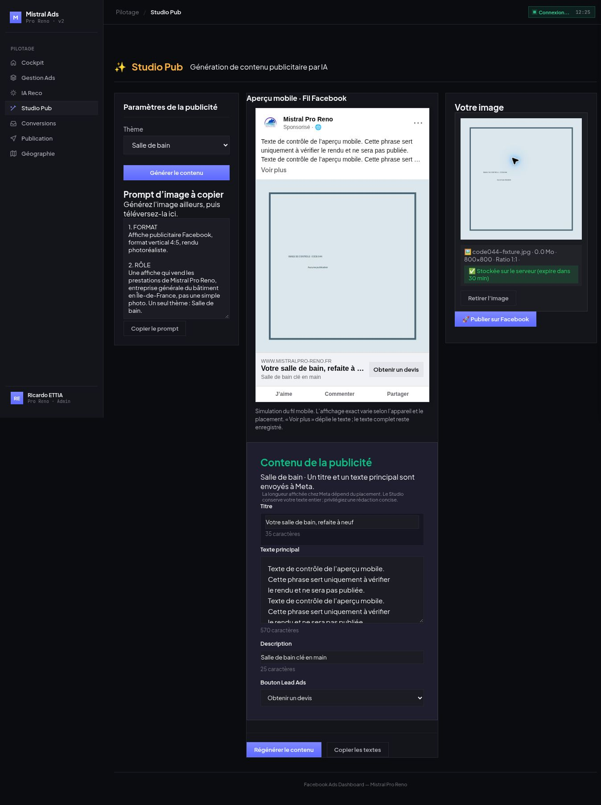

# CODE-044 — livraison et preuves

## Aperçu mobile

Le Studio retrouve la vignette et le nom réels de la Page via GET `/api/ai/studio-context` (repli sur le contexte métier si Graph indisponible), la mention Sponsorisé, le texte au-dessus de l’image, puis le domaine, le titre, la description et le CTA. Le bouton d’aperçu ne publie rien. L’image conserve ses proportions. Le rendu se met à jour à chaque saisie, changement de CTA, téléversement, remplacement ou retrait d’image.

`js/studio-preview.js` et `css/ai-creation.css` utilisent une carte de largeur maximale 390 px et un masquage CSS sur trois lignes. Le débordement réel (`scrollHeight > clientHeight`) révèle « Voir plus » ; le clic retire le masquage, « Voir moins » le remet. Titre sur une ligne, description sur deux lignes. Aucune sous-chaîne n’est créée pour le texte envoyé ou enregistré. Le module Publication de CODE-043 reste intact.

**Limite : simulation du fil mobile, pas aperçu natif Meta.** Facebook varie selon appareil et placement ; trois lignes ne garantissent pas sa coupure exacte. Cette limite est affichée dans le Studio. Le numéro est un lien `tel:` dans cette simulation ; sa reconnaissance automatique dans l’annonce réelle dépend de Meta et du terminal.

Chrome en production : 570 caractères dans le champ et le DOM d’aperçu avant/après « Voir plus » ; hauteur réduite 60 px, complète 240 px. Après suppression manuelle du téléphone, aucun lien téléphonique ne revient, y compris après dépliage. Image neutre 800 × 800 téléversée uniquement dans le stockage temporaire du backend, puis retirée par le bouton du Studio. Aucun clic sur Publier. Le premier fichier 566 × 752 a été rejeté par le minimum existant de 600 × 600 ; aucun changement de cette validation.

## Source unique du téléphone

`backend/config/business-context.json` contient l’unique valeur métier du numéro. `services/studio-content.js` charge ce contexte dans BRAND, puis `businessContext(db)` le transmet à `services/claude-api.js::generateAdContent`. Après normalisation, `appendCompanyPhone` ajoute deux sauts de ligne et le numéro à la fin du texte principal. Si ce même numéro apparaît déjà, y compris en formats espacés, pointés, tiretés, +33 ou 0033, le texte original reste intact. Un ancien littéral dans le prompt image est remplacé par la lecture de cette même configuration.

Aucun ajout dans le rendu, l’éditeur ou la préparation de publication : le Gérant peut supprimer ou modifier le numéro sans réinsertion. Une nouvelle génération ajoute de nouveau le numéro du contexte, comme demandé. Un changement de numéro se fait dans ce fichier, puis par déploiement/redémarrage du backend. Aucun écran de paramétrage supplémentaire n’est créé.

## Validation et livraison

Node 20.11.1 : backend 155/155, frontend 65/65, dont quatre nouveaux tests par dépôt. Couverture : source métier, ajout/dédoublonnage et préservation du texte long, génération simulée, GET profil en lecture seule/repli ; rendu échappé, débordement/dépliage sans mutation, mise à jour image/CTA/téléphone, suppression conservée dans le payload. Syntaxe JavaScript et `git diff --check` validés. Pas d’appel réel au modèle pour ces vérifications.

| Dépôt | Base main | Commit livré sur main et code-044 |
|---|---|---|
| Backend | 1352e77ce71afb9fe94bf7d3b1d183bf61f84047 | 78fa5535acf1e06618669863812d873e0952a121 |
| Frontend | fdc415636c0fafaf7d2e18ac3afbea357ce98ade | 2274e5d043e493f2e684a05b80ff55d2df22ff5c |

Render : `srv-d6cq3hi4d50c73aa1rkg`, déploiement `dep-dbbk04ss728c73bha010`, live le 20/10/2026 à 10:20:00 UTC. Les trois assets frontend servis ont exactement les empreintes locales (preuve assets-servis.json). Publication Git avec contrôle de la tête attendue, sans force. Hub rebasé sur 4c4a9312c9a6eefcdfc5419d9ce4ea9fffb8c6ef avant rapport.

## Compte publicitaire préservé

Lecture GET des détails des deux annonces avant et après : IDs, statuts/effective_status, creative IDs, titre et texte principal strictement identiques (ads-avant.json / ads-apres.json). Salle de bain 120248281347920417 ACTIVE, creative 1135265525510950 ; Extension 120248878541540417 PAUSED, creative 1130229799713439. Aucune écriture Meta, aucune republication, aucun changement de budget, ciblage ou statut. Les anciennes fins de texte « pas de » et « Étude de » restent chez Meta en attente de la republication du Gérant.

Formulaire CODE-042, IA Reco, Conversions, HOUSING/D5, mode réduction et protection 72 h préservés ; service SaaS interdit non touché.

Preuves : tests.json, telephone.json, contexte.json, verification-ui.json, apercu-mobile.jpg, deploiement.json, assets-servis.json, ads-avant.json et ads-apres.json dans preuves-code-044/.
