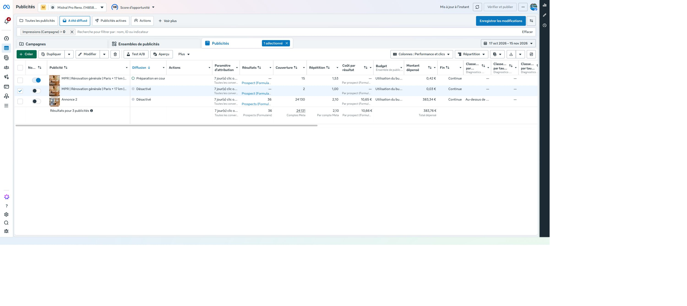
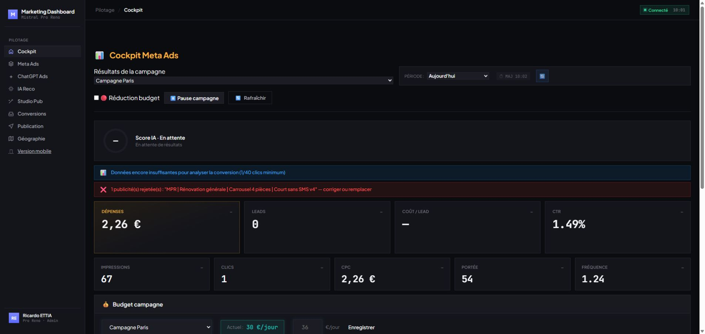
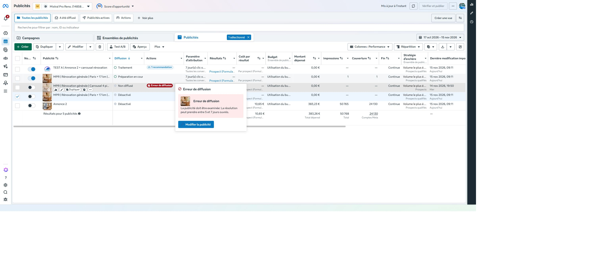

# CODE-047 — reprise 2 — fusion, recette réelle et retour arrière

15 novembre 2026. Horaires ci-dessous en **Europe/Paris (UTC+1)**. **NON validé : production restaurée après défaut bloquant du total et de l’historique.** Autorisation de fusion/déploiement et de rollback : message CODE-047 reprise 2, accord du Gérant du 15/11 à 09:53.

## Déploiements et retour arrière

| Couche | Fusion | Déploiement candidat | Déploiement du revert |
|---|---|---|---|
| Backend #22 | 464e58d45c1c2fd183f21f22288f35d744f5c266 | dep-dbsn75c9v7es73c3m6vg, live 09:56:35 | dd2c192915ca8256f23ed9d5bdb64117e16885cc ; dep-dbsn8lmq1p3s73f0d30g, live 09:59:55 |
| Frontend #20 | a308aadb17c002212feb8a07fdf25071c65f3db4 | 6af973ee30d430e8675d16c8, publié 09:57:27 | a44aa026612e4f0763cd9ad17a721aea374279fb ; 6af97454d3a3ecf1fcf532cd, publié 09:59:05 |

Les PR sont passées de brouillon à prêtes puis ont été fusionnées avec contrôle du SHA attendu. Aucun rebase nécessaire : main backend était encore 3db9c13, frontend b9b0740. Backend fusionné, Render live et health healthy vérifiés avant fusion frontend. Service Render unique : **mistral-pro-reno-backend / srv-d6cq3hi4d50c73aa1rkg**, jamais fb-ads-saas. Site Netlify : mistral-fb-ads-dashboard / 04d5638d-0357-4f4c-a808-cfaada13a585.

Le retour arrière a été exécuté immédiatement dès le résultat incomplet, **frontend puis backend**, par deux commits de revert conservant l’historique Git. Les têtes main n’avaient pas bougé depuis les fusions : les reverts reprennent exactement le premier parent de chaque fusion, sans supprimer de travail concurrent. Arbres vérifiés : frontend 61194bbc04bbab4bc0397c714b04c299c72d93ed, backend 2692cf1c3e0c58641ccfb001c64db911046577d5. Ce sont les arbres antérieurs b9b0740 / 3db9c13. Health après restauration : HTTP 200 healthy à 10:00:43.

Preuve sans secret : [deployments-and-rollback.json](preuves-code-047/reprise-2/deployments-and-rollback.json).

## Recette réellement exécutée avant rollback

Lectures GET uniquement sur le backend de production, via sa configuration applicative existante maintenue en mémoire et non copiée dans les preuves. Période explicite since=2026-10-17, until=2026-11-15. Les accès et en-têtes d’authentification ne sont pas journalisés ni conservés dans les preuves. Aucun jeton Meta du serveur n’a été extrait.

Relevé API terminé **09:58:01** :

| Contrôle | Constat réel | Verdict |
|---|---|---|
| Nouveau Cockpit | Campagne Paris visible dans l’en-tête et sélectionnée | Observé ; cas sans mémorisation non isolé |
| Total campagne, /insights | 390,76 € ; 36 prospects ; 1 151 clics ; bornes correctes | Référence campagne réelle |
| Total /ads/details, campagne Paris | 383,76 € ; 36 prospects ; 1 137 clics | NON : somme des annonces incomplète par rapport à la campagne |
| Annonce 2 | 383,34 €, 36 prospects ; PAUSED / PAUSED | Observé |
| Rénovation carrousel | 0,39 € ; ACTIVE / ACTIVE ; Diffusion Indéterminé | Fallback accepté par le Pilote, réellement reçu |
| TEST formulaire 14/11 | 0,03 € ; PAUSED / PAUSED ; Désactivé | Observé |
| Extension IDF 120248878541540417 | Absente de la réponse /ads/details ; historical_metadata_complete=false ; insights_available=true | NON : déclenchement du rollback |
| Court sans SMS v4, campagne REMPLACÉE | PAUSED / WITH_ISSUES ; Erreur de diffusion ; motifs français reçus | API observée ; survol UI candidat non réalisé |
| Cache de la route | Cache-Control: no-store dans la réponse HTTP 200 | Observé ; test complet du bouton interrompu |

**383,34 + 0,39 + 0,03 = 383,76 €**, contre 390,76 € au niveau campagne. L’écart observé est 7,00 €. La dépense historique connue de l’archivée est 6,99 € ; le centime restant peut dépendre du décalage de lecture pendant la journée courante mais n’est pas attribué avec certitude. L’absence de l’annonce historique suffit à invalider la recette, sans attendre une comparaison atomique des centimes.

Le problème n’était pas visible sur la fixture historique de la première livraison. Le candidat renvoie success=true avec historical_metadata_complete=false et un total d’insights partiel ; le frontend ne bloque pas ce total. La prochaine correction doit traiter à la fois la collecte historique réelle et l’affichage de complétude/réconciliation. La cause précise du rejet ou de l’omission par Graph n’est pas établie dans cette session : le connecteur de journaux Render exige une sélection explicite de workspace. Aucun workspace n’a été inféré et aucune collecte large de journaux n’a été tentée.

Preuve : [production-api-sanitized.json](preuves-code-047/reprise-2/production-api-sanitized.json). Elle contient uniquement IDs/noms d’annonces, statuts, mesures, motifs, horodatages et indicateurs de complétude ; URLs créatives et configuration ont été écartées.

## Diagnostics Graph reçus en production

La requête du candidat demandait id,status,effective_status,issues_info,ad_review_feedback,failed_delivery_checks,adset{id,status,effective_status},campaign{id,status,effective_status}, avec locale=fr_FR. **L’expansion a réellement répondu pour les annonces courantes** : la réponse applicative contient les statuts de l’annonce, de l’ensemble et de la campagne, un observed_at et les raisons françaises. En cas d’échec de ce diagnostic, le résolveur aurait conservé Indéterminé pour les annonces en pause ; ici elles ont bien été résolues Désactivé.

| Annonce | Statut annonce / effectif | Ensemble / campagne | Libellé applicatif |
|---|---|---|---|
| Rénovation carrousel | ACTIVE / ACTIVE | ACTIVE / ACTIVE | Indéterminé |
| TEST 14/11 | PAUSED / PAUSED | ACTIVE / ACTIVE | Désactivé |
| Annonce 2 | PAUSED / PAUSED | ACTIVE / ACTIVE | Désactivé |
| Court sans SMS v4 | PAUSED / WITH_ISSUES | PAUSED / PAUSED | Erreur de diffusion |

Raisons françaises exactes retournées pour Court :

```text
La publicité doit être examinée
La publicité doit être examinée: La résolution peut prendre entre 5 et 7 jours ouvrés.
```

Les espaces insécables du texte Meta sont conservés dans le JSON. Le candidat fusionne les textes de issues_info, ad_review_feedback et failed_delivery_checks dans reasons ; son contrat public ne renvoie pas les trois structures brutes séparément. **Leur présence distincte ou leur contenu vide ne peut donc pas être attesté individuellement depuis cette preuve.** Aucun champ brut supplémentaire n’a été inventé ni ajouté en production pour contourner cette limite.

## Gestionnaire, captures et contrôles interrompus

Le nouveau Cockpit a été vu réellement sur le domaine de production, avec la période globale et Campagne Paris. Dès le défaut API, les reverts ont été lancés. Une tentative d’ouverture de Meta Ads pendant la bascule a montré Failed to fetch vers 09:59:39 ; elle est postérieure à la décision de rollback et pendant le redéploiement, donc ne prouve pas un défaut JavaScript stable du candidat.

Le Gestionnaire a été ouvert dans un onglet de recette avec la plage 17/10–15/11. Il montrait le carrousel Préparation en cours, la copie TEST Désactivé et Annonce 2 Désactivé. La capture est prise après lancement du rollback, **pas simultanément aux lectures API de 09:58** : elle est conservée comme contexte daté, sans prétendre valider une comparaison simultanée complète. Le filtre « A été diffusé / Impressions campagne > 0 » est visible : il exclut la campagne REMPLACÉE et l’archivée. Cette vue filtrée n’est pas une preuve de complétude de la campagne.



Les contrôles « sans choix mémorisé », capture UI candidat avec archive en lecture seule, survol de Court et bouton Rafraîchir suivi d’une nouvelle lecture Graph ne sont **pas validés**. Ils n’ont pas été poursuivis au prix du maintien du candidat défectueux.

## Restauration et Conversions / CRM

Netlify et Render confirment les commits de revert effectivement servis. Après rechargement, le dashboard sert de nouveau l’ancienne interface : pas de colonne Diffusion Meta, sélecteur de période à son emplacement antérieur, Cockpit chargé. /health est healthy.

Conversions a été ouverte en lecture seule après restauration : aucun message d’erreur visible une fois le chargement terminé ; compteur 1 prospect et 5 conversations selon les filtres courants. Aucune fiche client, message ou coordonnée n’a été exporté, aucune action CRM ni communication n’a été effectuée. Cela vérifie l’accès et le rendu courant ; cela **ne prétend pas prouver exhaustivement l’intégrité de toutes les données**. Les arbres complets restaurés comprennent exactement le code Conversions/CRM antérieur.



Les erreurs réseau observées à 09:59:39 pendant la bascule n’apparaissent pas dans la vue Conversions restaurée. Aucun journal client contenant une donnée de prospect n’a été ajouté au rapport.

## Tests et suite

Aucun rebase, aucune nouvelle implémentation dans la reprise 2 : résultats Node 20.11.1 de la reprise 1 inchangés (backend 317 pass / 0 fail / 1 skip ; frontend 171 pass / seul échec préexistant CODE-041). La consigne de relance après rebase ne s’applique pas. Quatre node --check sur les sources antérieures ont également réussi après restauration. Les deux commits de revert reprennent des arbres déjà connus ; aucune correction fonctionnelle n’y a été introduite.

**État final : ancien code en production, CODE-047 non livré.** Nouvelle reprise nécessaire pour l’historique réel et la protection des totaux incomplets. Les fusions et le rollback restent dans l’historique ; ne pas simplement refusionner les branches déjà fusionnées. Préparer de nouveaux commits à partir du main restauré, contrôle Pilote puis nouvelle recette autorisée.

Aucune écriture Meta, aucune modification de budget, campagne, statut ou annonce ; saas intouchée. Aucun secret dans les preuves publiées.

---

# Historique — reprise 1, conservé pour traçabilité

# CODE-047 — reprise 1 — 15 novembre 2026

## Verdict et versions

**NON POUR FUSION.** Le code de la reprise est publié, les tests pertinents passent. La lecture réelle de Meta et du Gestionnaire a été effectuée, mais **le service candidat n’a pas été exécuté contre Graph réel**. Une lecture de référence n’est pas une recette du candidat. La correspondance exacte de « Préparation en cours » reste non établie avec les champs Graph publics vérifiés.

| Dépôt | Base de reprise | Commit livré | PR |
|---|---|---|---|
| Backend | ee35d112be2522d6cfb2f8aee124a42673b34947 | 071671107c76f38f08c82a4d0b09332f4324ae64 | [#22](https://github.com/seoettia-collab/facebook-ads-backend/pull/22) |
| Frontend | 6eef39d9c59c2075bf5b52fe8e4888abde9f6a81 | 68640b82784fa76e47955f8710e80eb80e1da8f2 | [#20](https://github.com/seoettia-collab/facebook-ads-frontend/pull/20) |

Branches : fix/code-047-reporting-coherence. Backend publié avant les modifications frontend. Les bases main restent 3db9c13 et b9b0740 ; aucun changement de saas, aucune fusion, aucun déploiement ni aucune écriture Meta. Les deux PR sont brouillons et GitHub indique mergeable=true / clean au contrôle final. Retour arrière après une éventuelle fusion : revert des commits, backend et frontend coordonnés.

## Changements de la reprise

| Couche | Fichier | Changement |
|---|---|---|
| Backend | services/meta-delivery.js | Résolution conservatrice des libellés, raisons Meta intactes, hiérarchie, statut Indéterminé explicite |
| Backend | services/facebook-api.js | Lecture GET fraîche séparée des diagnostics ; échec de diagnostic ne supprime pas les métriques ; logs GET de reporting sans texte brut |
| Backend | routes/campaigns.js | Retrait du cache 300 s sur GET /ads/details, Cache-Control: no-store |
| Backend | tests/code-047-reporting.test.js | Adaptation de l’isolation des tests et du faux objet réponse |
| Backend | tests/code-047-delivery.test.js | Quatre tests : ambiguïté, hiérarchie/motifs, fraîcheur, journalisation sûre |
| Frontend | index.html | Colonne Diffusion Meta à côté de Statut et signalement des annonces indéterminées |
| Frontend | js/ads-manager.js | Statut réglé, diffusion séparée, titres exacts et échappés, cache navigateur désactivé, lignes/squelettes à 13 colonnes |
| Frontend | tests/code-047-coherence.test.js | Tests de rendu adaptés et test ajouté de colonne, motif et rafraîchissement |

Les points 1, 2 et 4 acceptés sous réserve par le Pilote sont conservés : aucun ID de campagne par défaut, choix actif sinon active la plus dépensière, nom Meta visible ; période globale inclusive de Paris ; union annonces/insights/historique, historique sans boutons, données indisponibles distinctes de zéro. Les anciens MAIN_CAMPAIGN_ID et libellé fixe ne sont pas réintroduits.

## Champs Graph et limites établies

Référence primaire consultée : [Meta Graph API — Ad](https://developers.facebook.com/docs/graph-api/reference/adgroup/). API du service : v25.0. La lecture ajoutée, via GET multi-IDs de 50 objets, demande :

```text
id,status,effective_status,issues_info,ad_review_feedback,failed_delivery_checks,
adset{id,status,effective_status},campaign{id,status,effective_status}
locale=fr_FR
```

La requête est distincte de la lecture des métriques et des métadonnées créatives. Une absence de droit, un champ rejeté, une erreur d’objet ou un diagnostic manquant laisse la diffusion Indéterminé ; les dépenses et les lignes historiques sont préservées. La compatibilité réelle de cette expansion complète et des permissions du jeton serveur n’est pas validée dans cette session.

| Signal disponible | Résultat du candidat | Limite |
|---|---|---|
| status ACTIVE/PAUSED | Statut Actif/En pause, interrupteur correspondant | Ne vaut pas acceptation ni diffusion Meta |
| ARCHIVED ou DELETED | Archivée / Supprimée, lecture seule | Ne dépend pas d’une métrique récente |
| effective_status DISAPPROVED | Refusée + motifs Meta bruts | Motif manquant explicitement signalé |
| effective_status WITH_ISSUES | Erreur de diffusion + motifs Meta bruts | Le Gestionnaire peut séparer Diffusion et Actions |
| PENDING_REVIEW | En cours d’examen | Aucun IN_PROCESS assimilé à un examen |
| PAUSED confirmé dans le diagnostic | Désactivé | Diagnostic indisponible = Indéterminé |
| CAMPAIGN_PAUSED + campagne PAUSED | Campagne désactivée | Aucune déduction depuis le seul interrupteur de campagne |
| ADSET_PAUSED + ensemble PAUSED | Ensemble de publicités désactivé | À comparer au libellé Meta réel pour ce cas |
| ACTIVE, IN_PROCESS, PREAPPROVED ou code inconnu | Indéterminé + avertissement visible | Ni Active ni Préparation en cours inventé |

issues_info, ad_review_feedback et failed_delivery_checks sont lus. Les textes sont conservés dans les raisons de la réponse, avec les statuts source et observed_at. L’interface échappe les caractères HTML et guillemets ; aucun modèle ne traduit ou reformule les motifs. Le survol utilise title ; le texte est également exposé dans aria-label sur un élément focalisable.

Le connecteur officiel Meta disponible dans la session expose **delivery**, avec les alias delivery_info/delivery_status et des sous-statuts. Il a renvoyé pending/preparing pour le carrousel. Ce catalogue de connecteur n’établit pas que le même champ existe dans l’API Graph publique. Aucun champ non documenté, aucun accès aux API internes du Gestionnaire, aucun Windsor, aucune extraction de jeton du navigateur et aucun branchement du connecteur de conversation dans le produit n’ont été ajoutés.

## Lectures Meta réelles — source distincte du candidat

Compte autorisé : 1485808979635813. Période du **17/10/2026 au 15/11/2026**, Paris. Source : connecteur officiel « Mistral Pro Reno — Meta Ads », lectures seules. Référence enregistrée le 15/11 à 08:38:53 UTC. Aucun autre compte n’a été interrogé pour cette recette.

| Objet | Réglage / effectif | Diffusion renvoyée | Dépense | Prospects renvoyés |
|---|---|---|---:|---:|
| Campagne Paris | ACTIVE / ACTIVE | Non demandée au niveau campagne | 390,40 € | 36 |
| Annonce 2, 120248281347920417 | PAUSED / PAUSED | off/off | 383,34 € | 36 |
| Carrousel, 120249397519330417 | ACTIVE / ACTIVE | pending/preparing | 0,04 € | null |
| TEST 14/11, 120249397928260417 | PAUSED / PAUSED | off/off | 0,03 € | null |
| Extension IDF, 120248878541540417 | ARCHIVED / ARCHIVED | archived/archived | 6,99 € | null |
| Court sans SMS v4, 120249391658050417, autre campagne | PAUSED / WITH_ISSUES | error/with_issues | 0,00 € | null |

**383,34 + 0,04 + 0,03 + 6,99 = 390,40 €**, égal au total Campagne Paris. Les valeurs null du connecteur sont conservées dans la preuve JSON ; elles ne sont pas converties en zéro. L’archivée n’est pas apparue dans la liste courante du connecteur : une lecture explicite de son ID l’a retrouvée. La preuve de réconciliation est [meta-live-reference.json](preuves-code-047/reprise-1/meta-live-reference.json).

Les chiffres 388,53 € et 381,54 € du message de mission ne sont plus les chiffres réels au moment de la reprise. La plage comprend la journée courante et Meta continue de mettre à jour ses résultats. Le premier relevé UI de la reprise donnait encore 383,23 € pour Annonce 2 ; il précède la référence API ci-dessus. Il ne faut pas présenter ces captures à des instants différents comme une comparaison simultanée exacte.

## Comparaison avec le Gestionnaire réel

Un onglet de recette a été ouvert à partir de l’onglet Meta de l’utilisateur. Le sélecteur a été réglé via le calendrier sur **17 octobre – 15 novembre 2026**. Seuls la période, les filtres d’affichage, l’actualisation et le survol ont été utilisés. Aucun interrupteur, bouton Modifier, publication ou action d’écriture n’a été déclenché. L’onglet de travail existant de l’utilisateur n’a pas servi à modifier des annonces.

| Cas | Gestionnaire réel observé | Candidat attendu avec les champs Graph seuls | Verdict |
|---|---|---|---|
| Annonce 2 | Désactivé | Désactivé si diagnostics accessibles | Parité plausible, à exécuter contre Graph |
| Carrousel | Préparation en cours | Indéterminé | Diffusion exacte non reproductible, signalée |
| TEST formulaire 14/11 | Désactivé, évolution depuis le tableau initial | Désactivé si diagnostics accessibles | État initial du message dépassé ; candidat à exécuter |
| Court sans SMS v4 | Diffusion : Non diffusé ; Actions : Erreur de diffusion | Erreur de diffusion selon WITH_ISSUES | Différence de placement/sémantique explicitée, pas une parité littérale prouvée |

Motif français exact au survol dans le Gestionnaire : **« La publicité doit être examinée: La résolution peut prendre entre 5 et 7 jours ouvrés. »** La lecture d’erreurs du connecteur, distincte du Graph candidat, a renvoyé le motif en allemand ; il n’a pas été traduit dans le code. Le candidat demande locale=fr_FR, dont le résultat effectif reste à vérifier avec le jeton serveur.




## Rafraîchissement, journaux et périmètre d’écriture

Le bouton Rafraîchir appelle à nouveau /ads/details. Le frontend utilise fetch cache:no-store ; la route n’a plus de cacheMiddleware ; la réponse porte Cache-Control:no-store. La méthode de détails ne consulte aucun cache interne pour ses lectures de diffusion et de hiérarchie. Une panne après un rafraîchissement ne conserve pas un ancien badge : erreur explicite ou Indéterminé.

Les anciennes captures/journaux détaillés de getAdsWithDetails ne sont pas réintroduits. Les erreurs GET de reporting sont journalisées sous FB_REPORT_READ_ERROR avec statut HTTP, code, sous-code et indicateur transitoire ; les erreurs par objet sous FB_REPORT_REVIEW_UNAVAILABLE avec code. Ni texte brut d’erreur, ni URL, ni configuration Axios, ni jeton ne sont enregistrés dans ces nouveaux journaux. Les routes et journaux hors de ce chemin restent inchangés.

La comparaison par exécution isolée et sérialisation des fonctions confirme **13 handlers POST/DELETE identiques à la base main 3db9c13**, notamment budget, statut, texte, créa, formulaire et duplication. Les **23 autres méthodes de service** sont identiques. Le client partagé ajoute seulement une option de journalisation pour GET ; ses branches POST restent inchangées. Preuve : [write-scope-reprise.json](preuves-code-047/reprise-1/write-scope-reprise.json) et [script de contrôle](preuves-code-047/reprise-1/check-write-scope.cjs).

## Tests et captures locales

Node **20.11.1**, commande dans chaque dépôt : node --test tests/*.test.js. Backend avec DATA_DIR isolé dédié aux tests, sans base de production.

| Contrôle | Résultat |
|---|---|
| Backend complet | 318 tests : 317 réussis, 0 échec, 1 intégration externe ignorée |
| Frontend complet | 172 tests : 171 réussis, 1 échec préexistant CODE-041 |
| Tests CODE-047 | 9 backend + 8 frontend : 17/17 |
| Syntaxe avant commits de reprise | node --check, 5 JS backend + 2 JS frontend : 7/7 |
| Recette locale Chromium ordinateur/mobile | Aucune erreur JS ; 5 lectures de détails ; aucune écriture Meta ; historique sans boutons ; raison intacte ; colonne séparée ; cas ambigu signalé |

L’échec frontend tests/code-041-leads-navigation.test.js:15 reste le même que sur la base b9b0740 : assertion de texte sur conversions.js, non modifié. Le Pilote l’a explicitement laissé hors périmètre. L’intégration backend ignorée attend une source devis externe SITE_ESTIMATE_DEVIS_SOURCE.

La recette locale utilise des API simulées et porte le bandeau **RECETTE LOCALE — DONNÉES SIMULÉES**. Elle ne prouve pas une connexion réelle du candidat. Son appel POST /api/ai/generate-image-prompt est également intercepté localement ; aucun service externe ni aucune annonce Meta n’a été modifié. Script et résultat : [qa-reprise.cjs](preuves-code-047/reprise-1/qa-reprise.cjs), [qa.json](preuves-code-047/reprise-1/qa.json).


## Reprise nécessaire avant D-024

1. Exécuter le commit backend candidat dans un service local ou une prévisualisation disposant de la configuration Meta serveur existante, sans copier les secrets dans les rapports.
2. Vérifier réellement l’expansion des diagnostics Graph et ses permissions ; préserver Indéterminé si une information manque.
3. Charger le candidat frontend sur la période fixe, relever simultanément résultats et libellés du Gestionnaire, vérifier l’archivée en lecture seule et la somme des lignes.
4. Résoudre ou accepter explicitement la limite preparing et la différence Diffusion/Actions du cas Court. Le fallback Indéterminé est livré ; la parité exacte n’est pas déclarée réussie.
5. Retour Pilote puis fusion backend avant frontend et déploiement seulement selon D-024.

Aucun accès serveur Meta configuré n’est disponible pour exécuter le candidat dans cet environnement ; le connecteur officiel ne propose pas une requête Graph arbitraire au nom du service. Cette limite ne doit pas être contournée par une extraction d’identifiants de session ou un test en production non autorisé.
