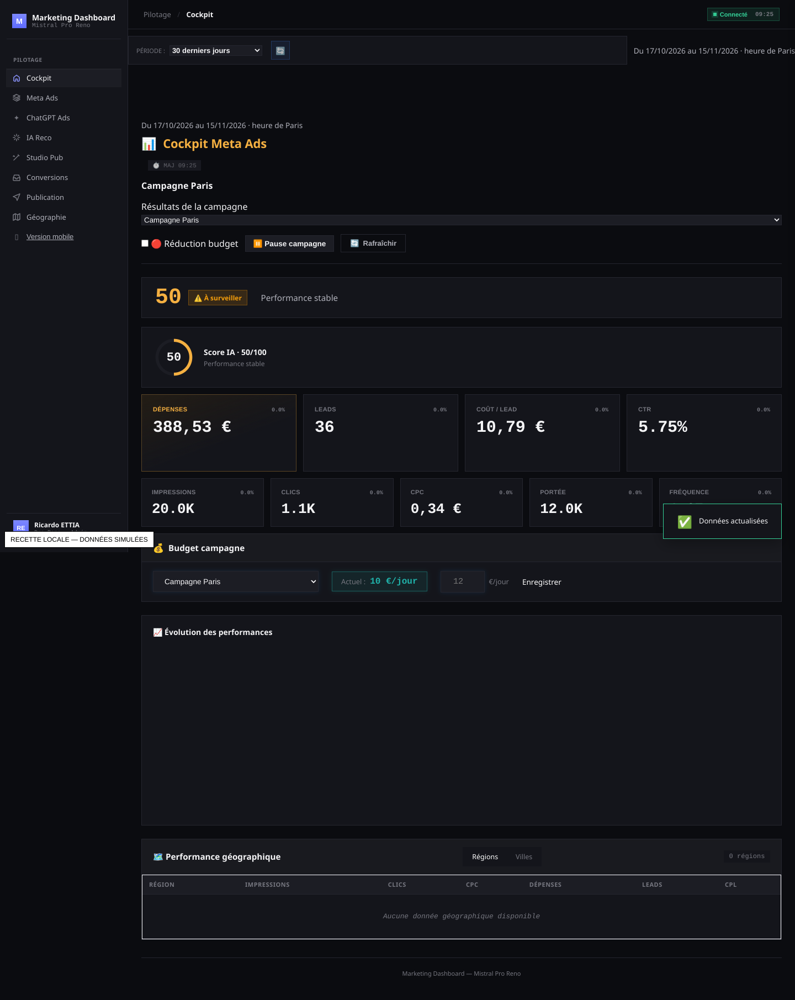
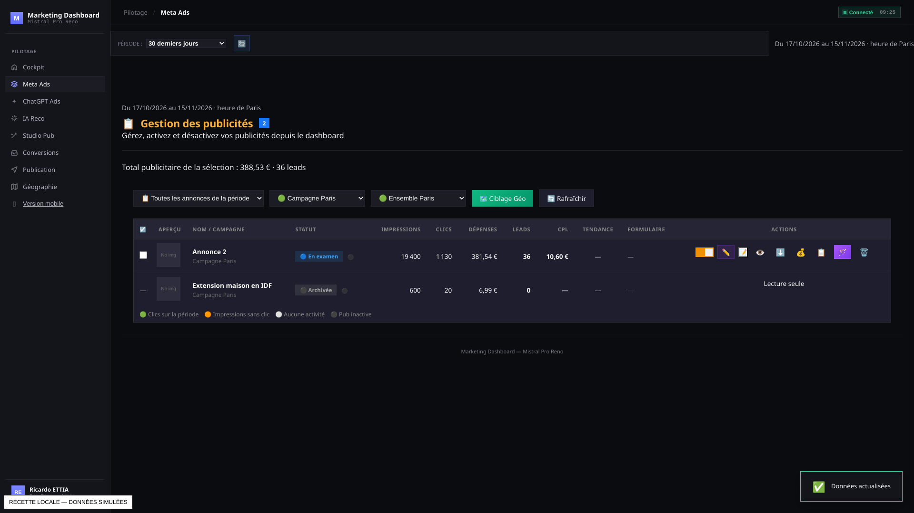
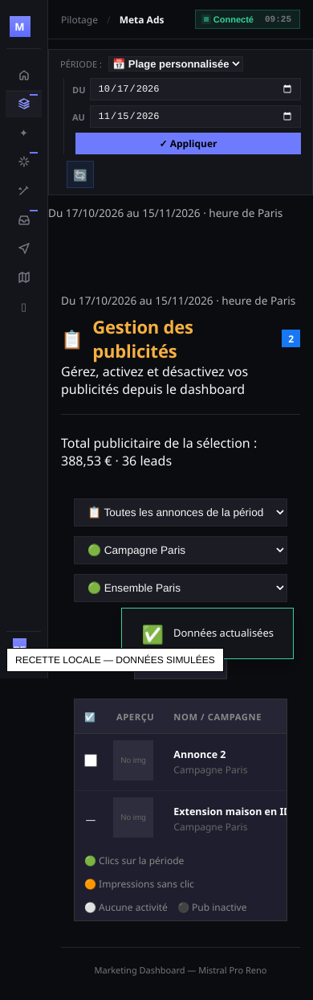

# CODE-047 — Annexe de livraison du 15 novembre 2026

## 1. Périmètre et références

Mission fournie directement dans la conversation du 15/11/2026 ; la boîte de mission du hub contient encore CODE-046 et n’a pas été rejouée ni modifiée. Fiche Codeur et gouvernance v3 lues au hub `6024e0a0fa844d8c46dbf6ce41552c2ee7d69b83`. D-013 appliqué sur demande expresse de cette mission.

| Élément | Base imposée et vérifiée | Livraison isolée |
|---|---|---|
| Backend | `3db9c13e55b707babe38e714a5d441ce4b4d189c` | `ee35d112be2522d6cfb2f8aee124a42673b34947` — [PR #22](https://github.com/seoettia-collab/facebook-ads-backend/pull/22) |
| Frontend | `b9b07406c0cce8a58ed8ee15dbb2a065121e15f7` | `6eef39d9c59c2075bf5b52fe8e4888abde9f6a81` — [PR #20](https://github.com/seoettia-collab/facebook-ads-frontend/pull/20) |

Branche dans les deux dépôts : `fix/code-047-reporting-coherence`. Backend implémenté, testé et poussé avant le frontend ; complément backend limité au signalement de métadonnées indisponibles et aux erreurs publiques. Commits backend `3883baf49f0a857875453ebffae1cc60deaf1341`, puis `ee35d112be2522d6cfb2f8aee124a42673b34947`. Aucune fusion, activation publicitaire ni écriture Meta effectuée. Branche saas non modifiée. Les deux main sont restées aux bases citées lors du contrôle avant publication.

## 2. Modifications

### Point 1 — Campagne

- Suppression de l’identifiant par défaut dans api.js et des variables MAIN_CAMPAIGN_ID dans Cockpit/IA Reco. Suppression du nom « Devis Rénovation IDF » utilisé comme libellé métier ou repli.
- Le chargement des campagnes précède les premières statistiques du Cockpit. Un choix mémorisé encore actif est conservé. Sinon : campagne active ; si plusieurs, classement par dépense sur les bornes choisies. Une dépense absente empêche un classement arbitraire.
- Le choix « Toutes les campagnes » explicitement enregistré reste respecté. Sans campagne active, l’écran présente Toutes les campagnes, sans inventer une campagne active. Seuls les choix explicites sont persistés.
- Le nom en tête provient des campagnes Meta. Les lectures/actions de budget existantes utilisent la sélection capturée, sans aucune exécution pendant cette mission.

### Point 2 — Période

- Contrôle de période déplacé hors de la vue Cockpit pour être accessible depuis les écrans Meta de statistiques ; il est masqué pour les vues distinctes, dont ChatGPT Ads.
- Les presets produisent des bornes explicites inclusives sur le calendrier Europe/Paris. Chaque écran Meta de statistiques affiche les dates complètes ; la plage personnalisée rafraîchit aussi le Gestionnaire.
- Les réponses de lectures arrivées après un changement de campagne ou de période sont écartées. Les caches statistiques portent le même contexte.
- Le Gestionnaire transmet les bornes à /ads/details ; les alertes du Cockpit utilisent également la période et la campagne choisies. Les comparaisons précédentes ont une durée inclusive identique.
- La route backend conserve les bornes fixes et refuse les dates invalides. Les erreurs ne sont pas présentées comme des mesures à zéro.

### Point 3 — Statut

Les badges utilisent uniquement effective_status : Active, En pause, En examen pour IN_PROCESS/PENDING_REVIEW, Refusée, Avec problèmes, Archivée, Supprimée, etc. Un statut inconnu reste « Statut indisponible ».
Le réglage status détermine l’état du bouton de commande : une annonce ACTIVE/IN_PROCESS est affichée En examen avec l’intention active ; PAUSED/IN_PROCESS reste En examen avec l’intention en pause. Aucune activation ou pause n’a été exécutée.

### Point 4 — Historique

- Pagination des annonces courantes et des insights, lecture explicite des statuts ARCHIVED/DELETED, puis union par identifiant d’annonce issu des insights du compte configuré. Les curseurs sont réutilisés sur un hôte/endpoint fixé, sans suivre des URL de pagination avec jeton.
- Les annonces absentes de l’arête courante sont conservées si elles ont des statistiques. Métadonnées relues par lots ; en cas d’absence, la ligne et ses mesures restent visibles, avec statut indisponible et lecture seule. Aucun statut Archivée/Supprimée n’est inventé.
- Historique : pas de boutons, pas de sélection A/B ; les commandes UI obsolètes sur une ligne désormais historique sont refusées. Le filtre initial affiche toutes les annonces de la période.
- Sommes calculées depuis les lignes d’insights, dépenses additionnées au centime. Les mesures manquantes et comparaisons non disponibles restent null/indisponibles. Une réponse insights réussie sans action lead rapportée signifie zéro lead ; cela est distinct d’un échec de lecture.
- La ligne organique Messenger existante est distincte des totaux publicitaires et n’est pas ajoutée lorsque la campagne ou l’ensemble est filtré.

## 3. Tests

Runtime exécuté : **Node v20.11.1**. Commande dans chacun des deux répertoires de travail ciblés :

```bash
node --test tests/*.test.js
```

Les tests backend utilisent DATA_DIR vers une base temporaire ; aucun prospect réel n’a été consulté ni modifié.

| Vérification | Résultat |
|---|---|
| Backend complet | 314 tests : 313 réussis, 0 échec, 1 ignoré |
| Frontend complet | 171 tests : 170 réussis, 1 échec préexistant |
| Nouveaux tests CODE-047 | 5 backend + 7 frontend, tous réussis |
| node --check avant commits | 4 fichiers JS backend + 8 frontend : 12/12 |
| Baseline frontend CODE-041 isolée | 7 tests : 6 réussis, même échec à la ligne 15 |
| Navigateur local | Aucune exception JS ; 3 captures, ordinateur et mobile |

Test backend ignoré : intégration estimateur/devis nécessitant une source externe SITE_ESTIMATE_DEVIS_SOURCE, ignorée par la suite existante sans cette variable. Il ne porte pas sur CODE-047.

**Réserve conservée :** `tests/code-041-leads-navigation.test.js:15` attend textuellement `escapeHtml(formatLeadProjectValue(e[0], e[1]))` dans conversions.js. L’assertion échoue aussi avec les fichiers exactement lus sur `b9b0740`. Les fichiers CRM/postaux n’ont pas été modifiés. Le rapport ne présente donc pas la suite frontend comme entièrement verte.

Les nouveaux tests couvrent : choix absent/périmé, choix actif et Toutes explicites, résolution avant premier chargement, classement sur dépense de période, aucun ID par défaut, dates inclusives de Paris, plage fixe/personnalisée, dates visibles, réponses tardives, rendu réel des lignes, distinction status/effective_status, aucun contrôle historique, pagination, métadonnées inaccessibles et absence de faux zéros.

## 4. Recette locale et captures — données simulées

**Ces captures ne prouvent pas les mesures ni le statut actuel de production.** Le navigateur utilise les fichiers candidats et une API entièrement simulée avec les valeurs de référence de la mission, en locale fr-FR. Un bandeau « RECETTE LOCALE — DONNÉES SIMULÉES » marque les captures. Les appels externes et Chart.js sont remplacés dans cette recette de tableau ; le rendu du graphique n’est pas validé par ces captures.

Le démarrage d’un module Studio existant tente un POST de génération de prompt ; il est entièrement intercepté et simulé dans le harnais, sans appel IA réel. Aucune requête d’écriture Meta n’est exécutée. Voir [qa.json](preuves-code-047/qa.json) et [harnais local](preuves-code-047/qa.cjs).

| Cas simulé du 17/10 au 15/11 | Résultat constaté |
|---|---|
| Préférence sur campagne remplacée / aucun choix | Campagne Paris choisie à partir des métadonnées actives |
| Cockpit | 388,53 €, 36 leads |
| Annonce 2 | 381,54 €, 36 leads, En examen (fixture IN_PROCESS) |
| Extension maison IDF | 6,99 €, 0 lead, Archivée, lecture seule sans bouton |
| Somme dépenses | 381,54 + 6,99 = 388,53 € |
| Plage personnalisée depuis Gestionnaire | GET details avec since=2026-10-17 et until=2026-11-15 |
| Mobile 390 px | Bornes, bouton Appliquer et dates complètes accessibles |





## 5. Fichiers

| Dépôt | Fichier |
|---|---|
| Backend | services/facebook-api.js |
| Backend | routes/campaigns.js |
| Backend | services/reporting-period.js (nouveau) |
| Backend | tests/code-047-reporting.test.js (nouveau) |
| Frontend | js/api.js |
| Frontend | js/state.js |
| Frontend | js/cockpit.js |
| Frontend | js/ads-manager.js |
| Frontend | js/ai-recommendations.js |
| Frontend | js/navigation.js |
| Frontend | index.html |
| Frontend | tests/campaign-scope.test.js |
| Frontend | tests/code-047-coherence.test.js (nouveau) |

## 6. Contrôle et déploiement restant au Pilote

1. Examiner les deux PR et la réserve CODE-041. Elles restent en brouillon pour contrôle.
2. Après validation du Pilote, fusionner/déployer le backend avant le frontend.
3. Réaliser la recette réelle sur les bornes fixes 2026-10-17 / 2026-11-15, avec noms/statuts relus de Meta au moment de la recette. Vérifier notamment pagination, somme des lignes et absence de commandes historiques.
4. Recharger le frontend pour éviter les scripts précédemment mis en cache.
5. Retour arrière : revert des commits, sans modification de données ou de campagne.

Aucune migration de base, nouvelle infrastructure ou connexion Windsor dans le dashboard. Aucun changement d’authentification, de budget, de campagne ou de statut Meta.

## 7. Sources techniques

- [Référence officielle Meta Ad](https://developers.facebook.com/docs/graph-api/reference/adgroup/) : statuts effectifs et arête de lecture.
- [Référence officielle Meta Ads](https://developers.facebook.com/docs/graph-api/reference/ad-campaign/ads/) : les lectures par défaut excluent les annonces archivées/supprimées sans paramètre de statut.
- [Insights Meta](https://developers.facebook.com/docs/marketing-api/insights/) : lecture des statistiques par niveau.
- Sources applicatives et tests lus aux commits de base ci-dessus ; modifications relisibles aux hashes de livraison et aux PR.
