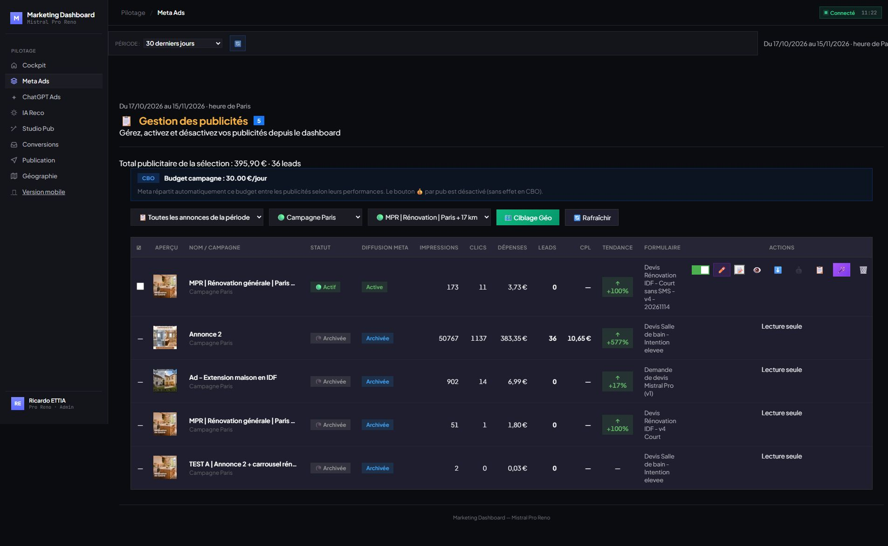
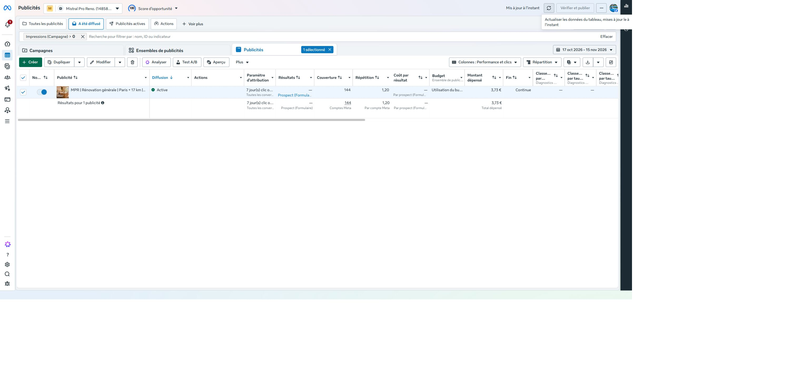

# CODE-048 — recette du 15 novembre 2026

Horaires Europe/Paris (UTC+1). **OK : règle du jour déployée et affichage Active concordant avec le Gestionnaire.**

## Implémentation

Branches fix/code-048-delivery-today depuis le main CODE-047 reprise 3 : backend 7a92114, frontend 277ef52. Aucun rebase nécessaire.

services/meta-delivery.js exige effective_status=ACTIVE pour l’annonce, son ensemble et sa campagne, diagnostics disponibles, puis au moins une impression dans la journée courante de Paris. Le statut configuré des parents ne suffit pas. Avec zéro impression, le libellé reste Indéterminé et le motif exact est « Meta indique ACTIVE, aucune diffusion constatée aujourd'hui ». Une lecture absente, en erreur ou incomplète reste Indéterminé.

services/facebook-api.js lit séparément ad_id,impressions avec level=ad, pagination complète et time_range du seul jour de Paris. Cette lecture est faite lorsqu’une hiérarchie entièrement ACTIVE est reçue. Une réponse réussie sans ligne pour une annonce équivaut à aucune impression aujourd’hui ; une panne ou une réponse invalide n’est pas convertie en zéro. Une erreur sur une seconde page invalide l’ensemble de la lecture du jour. Le résultat de preuve est exposé dans delivery.today : time_range, available, impressions. Il ne remplace jamais metrics ni totals de la période écran.

js/ads-manager.js donne au libellé confirmé Active la classe ads-badge-active. Le motif de zéro impression est conservé et échappé dans le titre de survol et aria-label. Les commandes restent liées au réglage status. Les autres règles de statut sont inchangées, y compris pour une archivée ayant eu des impressions aujourd’hui.

Aucune nouvelle dépendance, aucune route d’écriture modifiée, aucun secret ni configuration fournisseur ajouté. [Contrôle du périmètre d’écriture](write-scope.json).

## Fusion et déploiement

| Couche | Livré | Déployé |
|---|---|---|
| Backend [#24](https://github.com/seoettia-collab/facebook-ads-backend/pull/24) | commit 83adc5757ca86b27dd5a0b619bb79060068498ea ; fusion bc591bc91f0c4db3618da852912e2ca860a3cd51 | Render dep-dbsoe7e8bjmc73eovmdg, live 11:20:03, service srv-d6cq3hi4d50c73aa1rkg uniquement |
| Frontend [#22](https://github.com/seoettia-collab/facebook-ads-frontend/pull/22) | commit 278ba792dd21248ab991a594d1d4b6c2d7b93296 ; fusion e4419144ca0618c75413d84a07e2424be9ff1bda | Netlify 6af987872f5d78688ec19591, ready et publié 11:21:01 |

Backend live et /health healthy vérifiés avant fusion frontend. Les commits servis correspondent aux fusions. [Métadonnées de livraison et tests](deployments-tests.json), [health avant frontend](health-backend.json), [health final HTTP 200 healthy à 11:24:12](health-final.json).

Aucun déclencheur de rollback détecté. Retour arrière prêt : revert frontend e441914 puis backend bc591bc, avec contrôle des têtes courantes pour préserver toute modification ultérieure. Pas de reset destructif.

## Tests

Node 20.11.1, node --test tests/*.test.js dans chaque dépôt. DATA_DIR backend dédié aux fixtures.

| Contrôle | Résultat |
|---|---|
| Backend complet | 323 tests, 322 réussis, 0 échec, 1 intégration devis externe ignorée |
| Frontend complet | 174 tests, 173 réussis, seul échec préexistant tests/code-041-leads-navigation.test.js:15 hors périmètre |
| Ciblés CODE-047/048 | 24/24 |
| Syntaxe avant commits | node --check : 4 fichiers JS backend, 2 frontend, 6/6 |

Couverture ajoutée : trois effectifs ACTIVE + 1 impression ; zéro avec motif exact ; ligne du jour absente ; lecture en panne ; pagination interrompue ; métrique du jour absente ; parent non actif ; diagnostics absents ; statuts hors ACTIVE inchangés. Journée de Paris vérifiée à minuit et en été. Sur une période affichée ancienne de 30 jours avec 9 000 impressions, le libellé dépend de la lecture du jour (0 ou 1), sans changer les 9 000 impressions, la dépense 50 ni le rapprochement. Le test frontend vérifie la classe verte et le titre exact échappé.

Les scénarios de panne et de zéro sont simulés uniquement dans les tests, pas par des modifications Meta réelles.

## Recette réelle

Lectures GET de production, compte autorisé 1485808979635813. Configuration applicative existante utilisée en mémoire, jamais écrite dans les preuves. Les réponses de preuve excluent la configuration, les en-têtes d’authentification et les URLs signées de créatifs.

Relevé à **11:22:34**, écran **30 derniers jours / du 17 octobre au 15 novembre** :

| Contrôle | Résultat réel |
|---|---|
| Sans SMS 120249397928260417 | ACTIVE, libellé Diffusion Meta Active |
| Lecture du jour | since=until=2026-11-15, available=true, **173 impressions** |
| Dépense Sans SMS | **3,73 €**, identique dans les deux interfaces de la fenêtre de recette |
| Tableau complet | 5 lignes ; 4 historiques sans button/input |
| Somme des dépenses | **395,90 €** |
| Référence campagne indépendante | **395,90 €** |
| Écart | **0,00 €**, reconciliation.status=complete |
| Prospects | **36** |
| Gestionnaire au même moment de recette | **Active**, après actualisation du tableau |
| JavaScript du dashboard depuis publication | Aucun nouvel échec relevé |

Le premier relevé backend à 11:20 donnait 169 impressions du jour et 395,86 € de total, déjà rapproché sans écart. L’évolution vers 173 / 395,90 € reflète la journée courante ; les relevés ne sont pas présentés comme des données figées au même centime à des instants différents.

La hiérarchie effectif ACTIVE est contrôlée par le résolveur avant l’établissement de Active ; les statuts configurés et effectif d’annonce sont également conservés dans la réponse. Le diagnostic et la lecture du jour ne réutilisent pas de cache de rapport. Les autres annonces restent Archivée même si elles ont eu des impressions aujourd’hui, conformément à la priorité des statuts historiques.

[Réponse API réelle filtrée](production-api.json).

Aucune écriture Meta, aucun changement de budget, statut, créa ou formulaire. Aucun accès à des fiches de prospects nécessaire pour cette recette. Branche saas intouchée. Le bouton d’action de l’annonce n’a pas été utilisé.

**État final : CODE-048 déployé, recette réelle réussie ; aucun retour arrière requis.**
